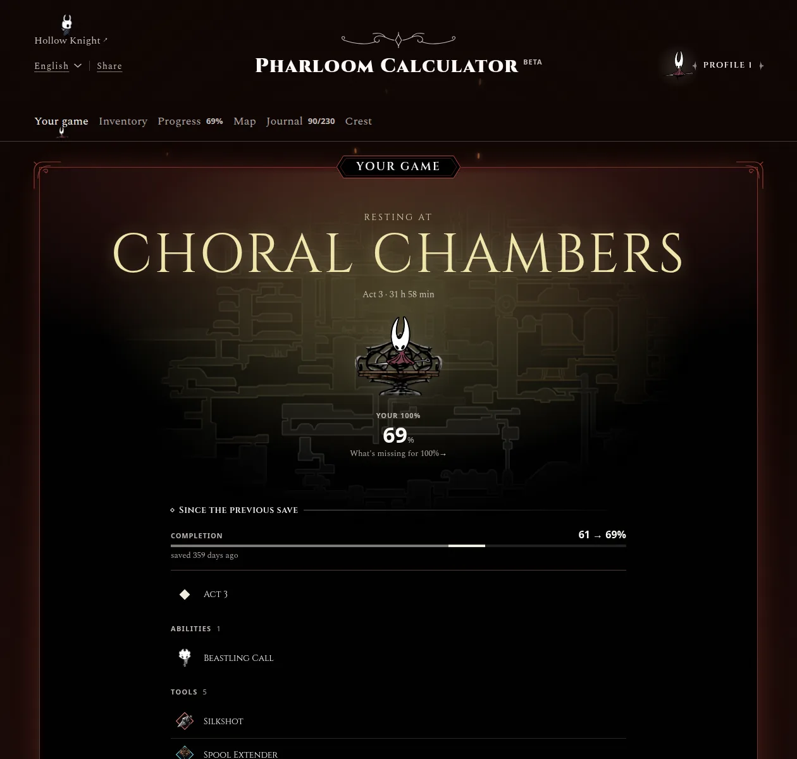
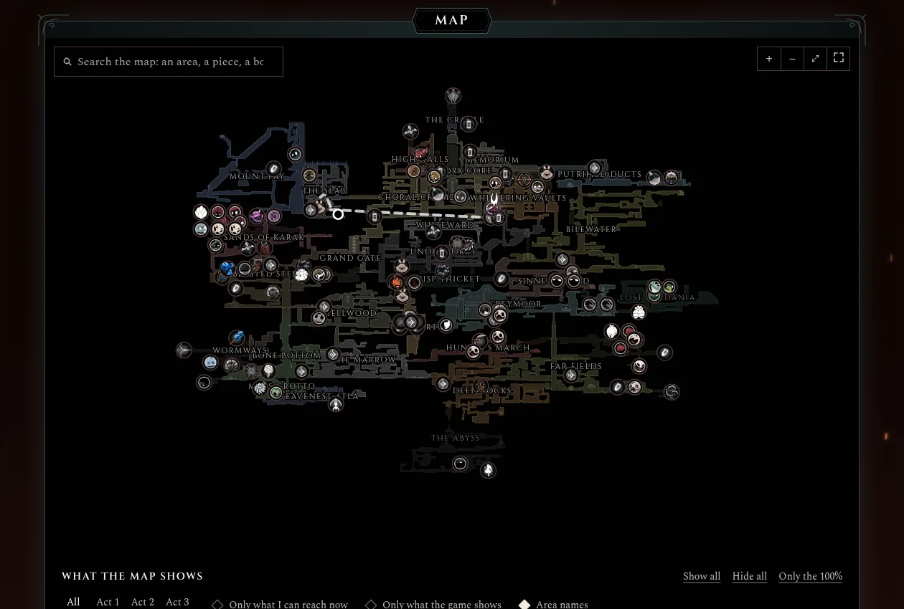
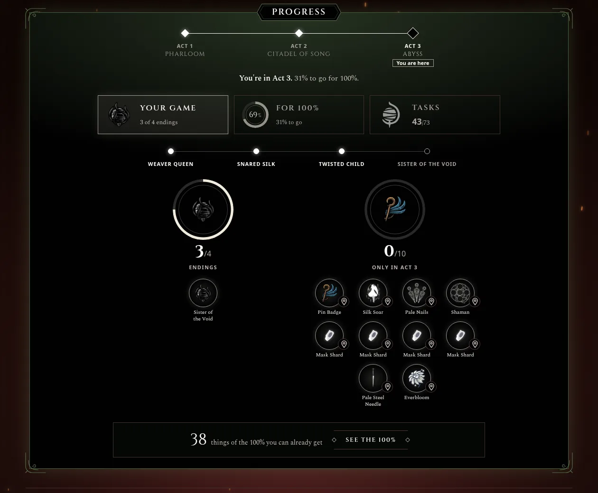
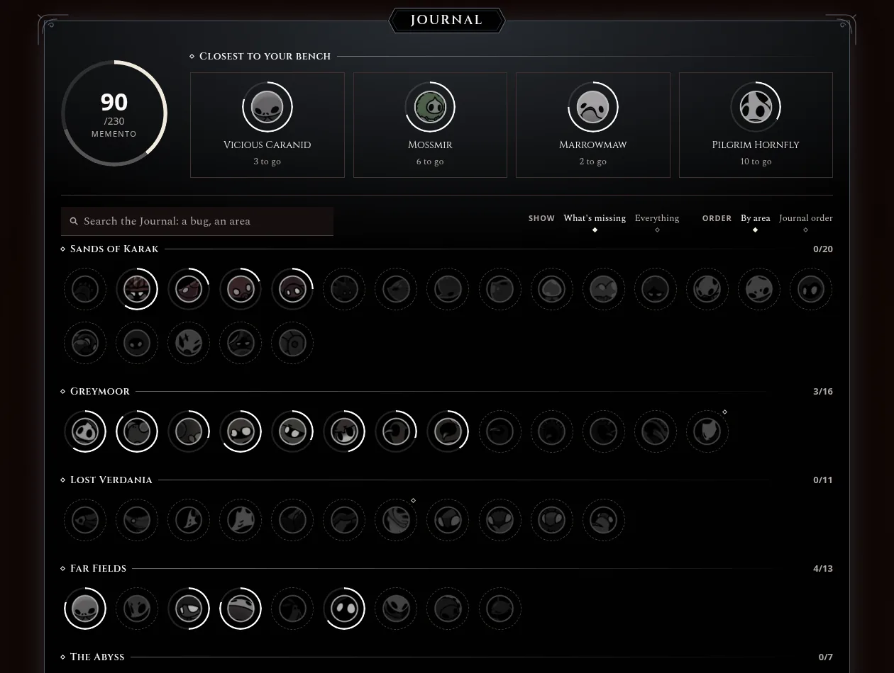
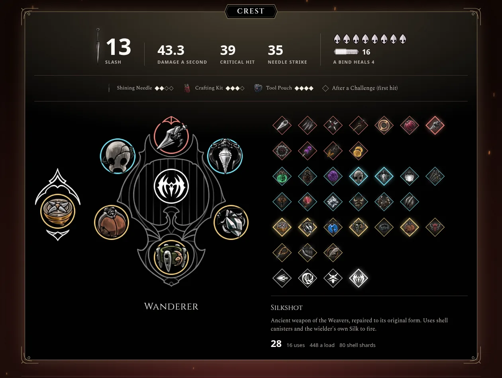
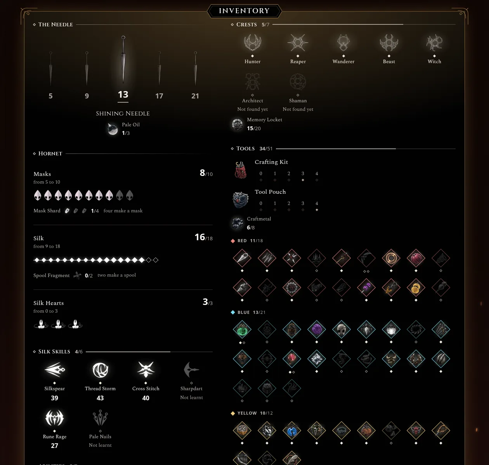
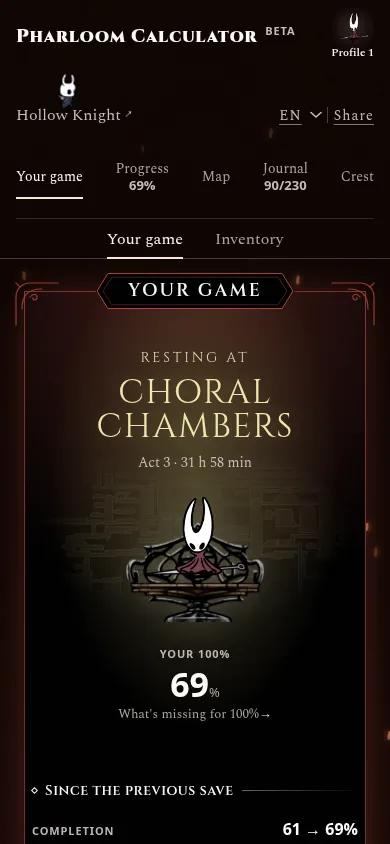
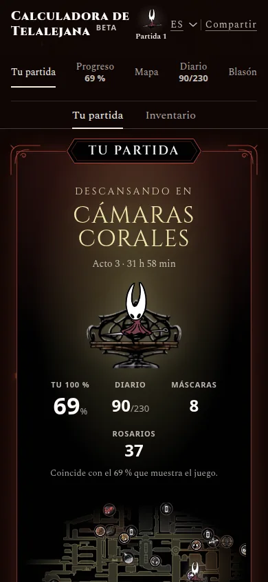

<div align="center">


# Pharloom Calculator

**Your real Hollow Knight: Silksong game, followed live, and every Tool's and Crest's effect on
Hornet. In English and Spanish.**

Import your save and the site shows it as the game does: the 100% item by item, the game's own
map with what you're missing, the Hunter's Journal and the road to the next Act. Keep playing, and
every time you sit on a bench it catches up and tells you what you got. Then try builds on the
game's own Crest screen: a Crest, its Tools, the Needle's level.

[**Open the calculator**](https://pharloomcalculator.com/)
&nbsp;·&nbsp; [Full guide](docs/guide.md)
&nbsp;·&nbsp; [Report a wrong number](https://github.com/betorzdev/pharloom-calculator/issues)

<br>

<!-- docs/screenshots/: npm run drive with a 69% save (Restore_Points1/restoreData24.dat, --prev
     restoreData22.dat), cropped and saved as WebP. -->


</div>

## What it does

<table>
<tr>
<td colspan="2" valign="top">

### Your game, live
Import your save file (`user1.dat`…, or any restore point) and **the site follows it**: with
Chrome or Edge, every time the game saves at a bench the page catches up by itself and says what
changed since the previous save. The start screen is a calm place: the area you rest in, with
Hornet on her bench, your 100% and **what changed since the previous save**; the rest of your
game is in its own tab. Four save slots, like the game's: a save is read and never changed
here (builds are tried in Free mode).

</td>
</tr>
<tr>
<td width="50%" valign="top">

### The Map
**The game's own map**, drawn piece by piece from its files with its own rules, and on it every
Tool, mask shard, spool fragment, flea, Memory Locket, bench and boss, found or not. Search it,
switch its layers, and see what the game itself wouldn't draw yet.

</td>
<td width="50%" valign="top">

### Progress
**Where you are**: the three Acts as the game titles them, the steps to open the next one, and
the **100% exactly as the game counts it**, part by part, with what you can already get, and the
game's **Tasks** (its wishes and main objectives) in a tab of their own. Equal to the game's own
figure on 92 real saves.

</td>
</tr>
<tr>
<td valign="top">

</td>
<td valign="top">

</td>
</tr>
<tr>
<td valign="top">

### Hunter's Journal
The **236 entries** by area or in the Journal's order, each in a ring that fills with its kills,
and the ones missing closest to your bench. The count works as Nuu's: 230 for the Hunter's
Memento (231 in Steel Soul).

</td>
<td valign="top">

### Crest
The game's Crest screen with **every Tool, Crest and upgrade**: equip them and see the slash,
damage per second, the Wanderer's critical, the Needle Strike, masks, silk and what a Bind heals.
Tools scale with the Crafting Kit, ammo with the Tool Pouch, as in the game.

</td>
</tr>
<tr>
<td valign="top">

</td>
<td valign="top">

</td>
</tr>
<tr>
<td valign="top">

### Inventory
Hornet as the save has her: the Needle, masks, silk and Silk Hearts, Silk Skills, abilities,
Crests and the 51 Tools by colour, with the Crafting Kit and the Tool Pouch.



</td>
<td valign="top" align="center">

### In your pocket, in two languages
Works just as well on a phone. English and Spanish, with every name copied from the game's own
text, never translated by hand.


&nbsp;


</td>
</tr>
</table>

## Why trust the numbers

- **The 100% is the game's**: the site counts as the game does, and `npm run check-pack` checks
  it against folders of real saves (92 so far, 0% to 100%, four patches, Steel Soul): every one
  matches.
- **Every value comes from [hollowknight.wiki](https://hollowknight.wiki/)**, with the game's
  own rounding (half to the even integer), and is checked by the tests.
- **The game's own files**: the map, the benches, each Crest's slots and slash timings, the shops
  and the wishes are extracted from the installed game.
- **The game's own words**: names are taken from its text, in both languages.

How each number is worked out is in the [guide](docs/guide.md#where-the-numbers-come-from).

## Run it

No framework, no build, no install. Double-click `index.html`, or serve the folder:

```sh
npm run serve                  # python3 -m http.server 8000, then http://localhost:8000
npm test                       # node --test, no dependencies
```

Combat (the damage calculator and the bosses' pages) is hidden for now; the code is still there.

Following a save live needs Chrome or Edge on a computer (the File System Access API); importing
it once works anywhere. On Linux, Chrome won't open the game's save folder (`~/.config`), so
there the save is imported, not followed.

<details>
<summary><b>The rest of the tooling</b>: data, pages, icons, checks</summary>

```sh
npm run text -- "Straight Pin" # the game's own text, in every language it ships
npm run kb                     # downloads the wiki's wikitext into kb/data/raw/
npm run data                   # regenerates js/data.js, enemies, journal, collectibles, gauntlets, how
npm run collectibles           # the completionist's dictionary, pinned (the save's fields)
npm run art                    # the game's sprites from the wiki; npm run icons, its icons
npm run pages                  # one page per search, in each language, sitemap.xml, robots.txt and CNAME
npm run site-icons             # the site's icons and favicon.ico, Hornet's head (needs Pillow)
npm run palette                # measures the game's colours on the wiki's sprites (needs Pillow)
npm run mark-fit               # measures each Map mark picture so all draw at one visible size
npm run admin                  # the Map's admin mode: place a mark right, saved to js/map-fixes.js
npm run check-pack -- <folder> # the site against a folder of real saves: the 100% must match
npm run drive -- --save <.dat> # any screen in headless Chrome with a real save, screenshotted
npm run trailer -- --before <save> --after <save>  # the announcement video (tools/trailer/make.js)
```

What's read from the installed game (each script's header says how):

| Script | Writes | What |
|---|---|---|
| `tools/extract-map.py` | `assets/map/`, `js/map.js` | The map's pieces and the rules that draw them |
| `tools/extract-graph.py` | `js/graph.js` | How the rooms connect |
| `tools/extract-entrances.py` | `kb/data/game/entrances.json` | Where each room's doors are, so what's inside an interior sits at its door on the Map |
| `tools/extract-battles.py` | | The arenas, and how a save marks each gauntlet cleared |
| `tools/extract-benches.py` | `js/benches.js` | Which bench each bench room has |
| `tools/extract-crests.py` | `assets/crests/`, `js/crest-slots.js` | Each Crest's art and where its slots sit |
| `tools/extract-hero.py` | `js/hero.js` | Each Crest's slash timings |
| `tools/extract-hornet.py` | `assets/hornet/` | The frames of the Hornet who walks the page |
| `tools/extract-journal-rooms.py` | `js/journal-rooms.js` | Where each Journal entry is found |
| `tools/extract-journal-art.py` | `assets/journal/` | Each Journal entry's whole drawing |
| `tools/extract-phases.py` | `js/phases.js` | Each boss's phases |
| `tools/extract-damage.py` | `js/enemy-damage.js` | What each common enemy does to Hornet |
| `tools/extract-quests.py` | `js/quests.js` | The wishes' rules: what opens Act 3, which comes first |
| `tools/extract-wish-icons.py` | `assets/icons/wishes/`, `assets/icons/tasks/` | Each type of wish's emblem, and the pictures the pane «Tasks» draws by each wish and main objective |
| `tools/extract-shops.py` | `js/shop.js` | What each vendor sells, for how much, and what each wish gives |

`npm run data` then joins the shops into `js/how.js`: how to get each thing of the 100%.

</details>

## Documentation

| | |
|---|---|
| [`docs/guide.md`](docs/guide.md) | Every screen in detail, the files, the numbers, the languages and privacy |
| [`design/`](design/README.md) | The study and the plan ([`00-study.md`](design/00-study.md)), the game's visual language, measured, and the UI review |
| [`kb/`](kb/README.md) | The wiki's wikitext and the game's text the site's data is generated from |
| [`CLAUDE.md`](CLAUDE.md) | The rules for working on the code and the translations |

The sibling for the first game is [Hallownest Calculator](https://github.com/betorzdev/hollownest-calculator):
this site was built from its skeleton.

## Credits

**Unofficial fan project**, free, not affiliated with or endorsed by
[Team Cherry](https://www.teamcherry.com.au/). *Hollow Knight: Silksong*, its artwork, texts and
names are © Team Cherry.

Data from [hollowknight.wiki](https://hollowknight.wiki/) (CC BY-SA 3.0); game texts from
[stradivari96/silksong-translator](https://github.com/stradivari96/silksong-translator);
fonts under the [SIL OFL 1.1](assets/fonts/OFL.txt). The code is [MIT](LICENSE): the licence
covers the code only, not the game's assets, the wiki's content or the fonts, which keep their
own. The details are in the [guide](docs/guide.md#credits-and-licences).

No cookies: your games stay in your browser, and the visit counter
([Footworn](https://github.com/betorzdev/footworn)) keeps no IP. See the [guide](docs/guide.md#privacy).

Made by **Albert** ([@betorzdev](https://github.com/betorzdev)) ·
[betorzdev@gmail.com](mailto:betorzdev@gmail.com)
